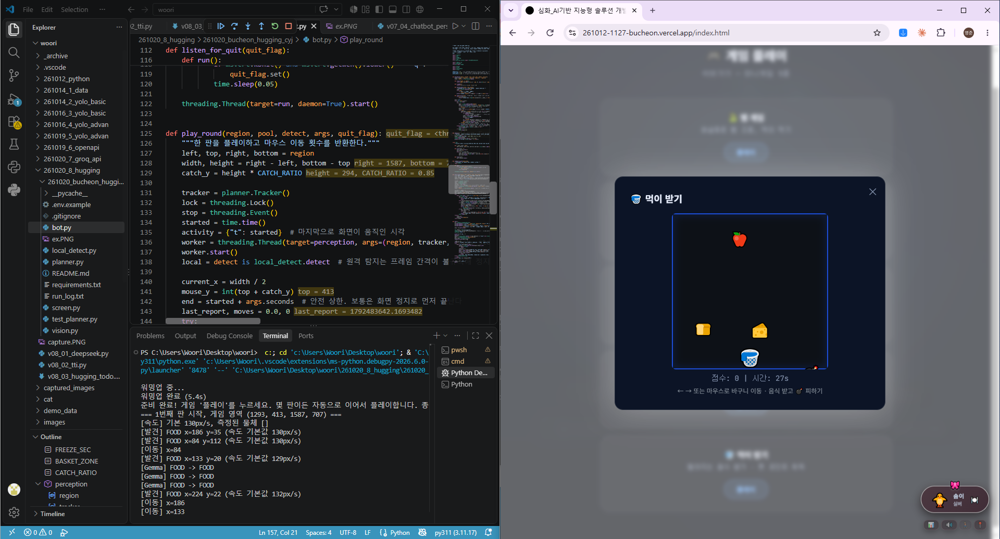

# 261020_bucheon_huggingface_cyj — 화면을 보고 스스로 플레이하는 "먹이 받기" 봇

웹 미니게임 **먹이 받기**를 **화면 캡처만으로 인식**해서 자동으로 플레이합니다.
게임 내부 코드나 DOM은 전혀 읽지 않고, 사람이 눈으로 보고 마우스로 움직이는 과정을
화면 인식과 HuggingFace의 VLM(Gemma 3)으로 대신합니다.



## 대상 게임

- **게임 종류**: 먹이 받기 (떨어지는 음식은 받고 폭탄은 피하는 30초 제한 게임)
- **게임 주소**: <https://261012-1127-bucheon.vercel.app/index.html>
- **규칙**: 바구니를 ←/→ 키 또는 마우스로 움직여 음식(사과, 포도, 닭다리, 케이크, 쿠키, 치즈, 딸기, 식빵)을 받고 폭탄은 피합니다.
- 이 봇은 **마우스로 바구니를 조작**합니다.

## 동작 방식

```
화면 캡처(mss) ─▶ 게임 영역 자동 탐색(파란 테두리, 팝업이 뜰 때까지 대기)
      │
      ▼
 로컬 블롭 검출(OpenCV, 약 5ms)   ← 물체의 "위치"를 프레임마다 찾음 (기본)
 └ 대안: --detector detr  → HF 원격 DETR (facebook/detr-resnet-50)
      │   새로 나타난 물체마다
      ▼
 색 규칙으로 즉시 임시 판정 ─▶ Gemma 3 (HF, google/gemma-3-27b-it)가 크롭을 보고 확인·정정
      │
      ▼
 추적 + 낙하 속도 추정 ─▶ 현재 위치 예측 ─▶ 마우스로 바구니 이동(pyautogui)
```

- **HuggingFace 모델의 역할**: 물체의 **종류 판정**을 Gemma 3(VLM)가 맡습니다. 제로샷 이미지 분류 모델은 현재
  HF Inference Provider로 서빙되는 것이 없어 VLM을 선택했습니다. 새 물체가 나타날 때마다 크롭을 보내 FOOD/BOMB를 확인합니다.
- **왜 위치 탐지는 로컬인가**: 원격 DETR를 실제 게임에서 써 보니 한 번에 0.6초(서버가 바쁘면 7~9초)가 걸리고,
  25px 정도의 작은 낙하물을 자주 놓쳤습니다(DETR의 라벨도 폭탄을 `traffic light`로 부르는 등 COCO 클래스라 쓸 수 없습니다).
  배경이 단색이라 로컬 블롭 검출이 5ms에 더 정확해서 기본값으로 두었고, DETR는 `--detector detr`로 비교할 수 있게 남겼습니다.
- **임시 라벨**: Gemma 호출(0.5~1초)을 기다리면 물체가 이미 바구니 근처라서, 폭탄(어두운 회색)과 음식(고채도)을 색으로
  즉시 판정해 먼저 움직이고 Gemma가 나중에 정정합니다.
- **속도 추정과 이동 시점**: 물체가 화면에 완전히 보인 뒤부터 최근 1초 관측값의 최소제곱 기울기로 낙하 속도를 구하고, 음식이 바구니에 닿기 1초 전부터 미리 옮겨 둡니다. 위에서 막 나타나 일부만 보이는 물체는 색과 속도가 왜곡되므로 다 보일 때까지 등록을 미룹니다.
- **폭탄 회피**: 음식이 떨어지는 자리에 폭탄도 같이 도착하면 그 음식은 포기하고, 현재 자리로 폭탄이 오면 피합니다.

## 설치

Python 3.11 권장.

```bash
python -m venv .venv
.venv\Scripts\activate          # Windows
pip install -r requirements.txt
```

### HF_TOKEN 설정

1. <https://huggingface.co/settings/tokens>에서 토큰을 발급합니다.
2. `.env.example`을 `.env`로 복사하고 토큰을 넣습니다. (`.env`는 `.gitignore`에 포함되어 커밋되지 않습니다.)
   상위 폴더에 `.env`가 있어도 자동으로 찾아 읽습니다.

```
HF_TOKEN=hf_xxxxxxxxxxxxxxxxxxxxxxxx
```

## 사용법

### 1) 실제 플레이

1. 게임 페이지를 열어 둡니다.
2. 봇을 실행합니다. 첫 실행은 워밍업(모델이 깨어나느라 수 초 걸림)을 합니다.

   ```bash
   python bot.py
   ```

3. "준비 완료" 안내가 나오면 게임 **'플레이'** 버튼을 누릅니다. 캔버스에서 물체가 0.6초 이상 **연속으로** 움직이면 게임이 시작된 것으로 보고 플레이합니다. (팝업을 여닫는 애니메이션은 짧아서 시작으로 오인하지 않습니다.)
4. 게임이 끝나면 화면이 멈춥니다. **화면이 2초 이상 정지하면** 한 판이 끝난 것으로 보고 "다음 판을 기다립니다"가 나옵니다. 게임을 다시 시작하면 **같은 실행에서 이어서 플레이**합니다. 팝업을 닫았다 열든, 팝업 안에서 다시 시작하든 상관없습니다.
5. **`q` 키**를 누르면 종료합니다. (`Ctrl+C`도 가능)

옵션:

| 옵션 | 설명 |
|---|---|
| `--dry` | 마우스를 움직이지 않고 판단만 출력 |
| `--detector detr` | HF 원격 DETR로 탐지 (기본은 로컬 블롭 검출) |
| `--seconds 45` | 한 판 최대 시간(안전 상한). 보통은 화면이 멈추면 먼저 끝납니다 |

모든 로그는 `run_log.txt`에 시간 표시와 함께 저장됩니다.

### 2) 판단 로직 단위 테스트

```bash
python test_planner.py
```

## 파일 구성

| 파일 | 역할 |
|---|---|
| `vision.py` | HF 원격 추론 호출 (DETR 탐지, Gemma 3 분류), 색 기반 임시 분류 |
| `local_detect.py` | 로컬 블롭 검출 (기본 탐지기) |
| `screen.py` | 화면 캡처, 게임 캔버스 자동 탐색 |
| `planner.py` | 낙하물 추적, 속도 추정, 이동·회피 판단 (외부 의존성 없음) |
| `bot.py` | 인식 스레드 + 제어 루프, 마우스 조작 |
| `test_planner.py` | 판단 로직 단위 테스트 |

## 한계와 주의

- 게임 캔버스의 **파란 테두리 색**(`screen.py`의 `BORDER`)으로 영역을 찾습니다. 게임 디자인이 바뀌면 값을 조정하세요.
- 원격 추론이라 네트워크 상태에 따라 반응 속도가 달라집니다. 첫 호출은 모델이 깨어나느라 수 초가 걸릴 수 있습니다.
- 바구니를 **마우스 위치**로 움직입니다. 게임이 마우스 조작을 지원한다는 전제입니다.
- 학습용으로 만든 연습 게임에서만 사용하세요. 점수가 랭킹이나 보상에 반영되는 서비스에 쓰면 부정행위가 될 수 있습니다.
